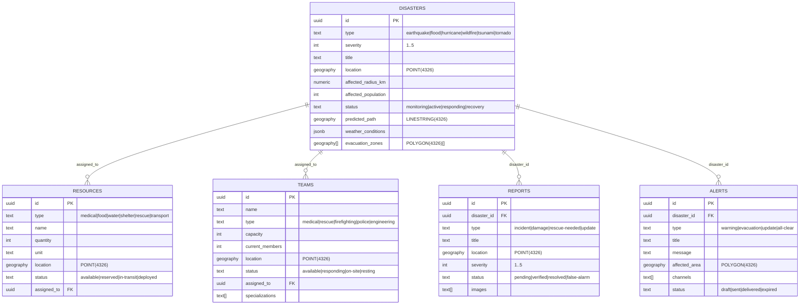

# Disaster Response Hub — System Architecture

## 1. Overview

**Disaster Response Hub** (`disaster-response-hub`) is a real-time, AI-powered disaster management and emergency coordination web application. It combines interactive 2D/3D geospatial visualization, live database synchronization, crowdsourced incident reporting, resource/team tracking, and Google Gemini AI-driven decision support into a single-page React application.

---

## 2. Tech Stack

| Layer                  | Technology                                            | Purpose                                                                                              |
| :--------------------- | :---------------------------------------------------- | :--------------------------------------------------------------------------------------------------- |
| **Frontend Framework** | React 18 (`^18.3.1`), TypeScript (`^5.5.3`)           | Component-based UI with static typing                                                                |
| **Build Tool**         | Vite (`^5.4.2`)                                       | Fast dev server and production bundling                                                              |
| **Styling & Icons**    | Tailwind CSS (`^3.4.1`), Lucide React (`^0.344.0`)    | Utility-first styling, glassmorphism UI, icons                                                       |
| **State Management**   | Zustand (`^4.5.1`)                                    | Centralized reactive store (`useDisasterStore`)                                                      |
| **2D Mapping**         | Mapbox GL JS (`^3.1.2`), `react-map-gl` (`^7.1.7`)    | Interactive dark-mode map, markers, GeoJSON layers                                                   |
| **3D Visualization**   | COBE (`^0.6.3`)                                       | Interactive WebGL 3D globe with severity-scaled markers                                              |
| **Analytics & Charts** | Chart.js (`^4.4.1`), `react-chartjs-2` (`^5.2.0`)     | Disaster severity trends (Line) & resource allocation (Bar)                                          |
| **Backend & Database** | Supabase (`@supabase/supabase-js ^2.39.3`)            | PostgreSQL + PostGIS, REST API, Realtime WebSockets                                                  |
| **AI Engine**          | Google Generative AI (`@google/generative-ai ^0.2.0`) | `gemini-pro` for chat, severity analysis, resource prediction, misinformation detection, and SITREPs |
| **Utilities**          | `date-fns` (`^3.3.1`)                                 | Date formatting and sorting                                                                          |

---

## 3. High-Level Architecture

The application follows a **Serverless Client-Side SPA** architecture where the React frontend communicates directly with **Supabase** (for persistence and real-time updates) and **Google Gemini API** (for AI inference), orchestrated through a central **Zustand** store.

```mermaid
flowchart TD
    User["User / Emergency Operator"] --> UI["React UI Layer (Dashboard, Map, Globe, Analytics, Modals)"]
    UI --> Store["Zustand Store (src/store/disaster.ts)"]
    UI --> Gemini["AI Service (src/lib/gemini.ts)"]

    Store <-->|"REST (CRUD)"| SupaDB["Supabase PostgreSQL + PostGIS"]
    Store <--|"WebSockets (postgres_changes)"| SupaRT["Supabase Realtime"]
    Gemini <-->|"generateContent (gemini-pro)"| GoogleAI["Google Generative AI API"]
    UI -->|"Vector Tiles & GeoJSON"| Mapbox["Mapbox GL API"]
```

---

## 4. Directory & Module Structure

```text
solutions-challenge-disastster-managements/
├── src/
│   ├── App.tsx                     # Root shell rendering Navbar + Dashboard
│   ├── main.tsx                    # React DOM entry point
│   ├── types.ts                    # Legacy/UI-level interfaces (DisasterAlert, ResourceUnit, EmergencyTeam)
│   ├── data/
│   │   └── mockData.ts             # Static mock data for UI testing/fallback
│   ├── lib/
│   │   ├── supabase.ts             # Supabase client initialization via Vite env vars
│   │   ├── database.types.ts       # TypeScript definitions for Supabase public tables
│   │   └── gemini.ts               # Google Gemini AI integration functions
│   ├── store/
│   │   └── disaster.ts             # Zustand store: state, CRUD actions, Realtime subscriptions
│   └── components/
│       ├── Dashboard.tsx           # Main layout, KPI cards, view switcher, modal triggers
│       ├── Navbar.tsx              # Top navigation bar (notifications, settings, help, profile, chat)
│       ├── Dock.tsx                # Floating dock for switching views and quick-access panels
│       ├── Map.tsx                 # Mapbox GL 2D map with GeoJSON evacuation/flood/route layers
│       ├── Globe.tsx               # COBE 3D interactive globe plotting active disasters
│       ├── Analytics.tsx           # Chart.js Line & Bar charts for trends and resources
│       ├── AIChat.tsx              # Context-aware Gemini AI assistant chat widget
│       ├── AIAnalysis.tsx          # On-demand AI severity, resource, misinformation & SITREP tools
│       ├── ReportIncident.tsx      # Modal form to submit geo-tagged incident reports
│       ├── ResourceModal.tsx       # Modal form to add emergency resources
│       └── AlertModal.tsx          # Modal form to broadcast multi-channel emergency alerts
└── supabase/
    └── migrations/                 # Sequential PostgreSQL + PostGIS schema & RLS migrations
```

---

## 5. Core Architectural Layers

### 5.1 Presentation & Component Layer (`src/components/`)

- **`App.tsx` & `Dashboard.tsx`**: `App.tsx` mounts `Navbar` and `Dashboard`. On mount, `Dashboard` triggers `fetchInitialData()` and `subscribeToUpdates()`, cleaning up with `unsubscribeFromUpdates()` on unmount. It renders 4 top-level KPI cards (`Active Disasters`, `Available Teams`, `Deployed Resources`, and `AI Assistant` trigger), a 600px main viewport switching between `Map`, `Globe`, and `Analytics`, and action modals.
- **`Map.tsx` (2D Geospatial)**: Uses `react-map-gl` (`mapbox://styles/mapbox/dark-v11`) to render disaster/resource markers, popups, and GeoJSON overlays (evacuation zones, flooded areas, rescue routes).
- **`Globe.tsx` (3D Geospatial)**: Uses `cobe` on an HTML `<canvas>` to render a rotatable 3D globe. Disasters from `useDisasterStore` are mapped to `[lat, lng]` markers with color-coding by disaster type and size scaled by `severity`.
- **`Analytics.tsx`**: Uses `react-chartjs-2` (`Line` and `Bar`) to plot disaster severity over time and compare `available` vs. `deployed` resources across 6 categories (`medical`, `food`, `water`, `shelter`, `rescue`, `transport`).
- **`AIChat.tsx` & `AIAnalysis.tsx`**: Provide conversational and structured AI workflows backed by `src/lib/gemini.ts`.
- **`ReportIncident.tsx`, `ResourceModal.tsx`, `AlertModal.tsx`**: Controlled modal forms with coordinate/field validation that dispatch mutations directly to `useDisasterStore`.

### 5.2 State Management & Real-Time Sync (`src/store/disaster.ts`)

`useDisasterStore` (Zustand) acts as the single source of truth for five domain collections:

- `disasters`
- `resources`
- `teams`
- `reports`
- `alerts`

**Key Data Flows:**

1. **Initial Hydration**: `fetchInitialData()` runs `Promise.all` across all 5 Supabase tables (`select('*')`) and populates the store while managing `loading` and `error` states. Seed arrays (`initialDisasters`, `initialResources`, `initialTeams`, `initialAlerts`) are defined as initial state before hydration.
2. **Real-Time Subscriptions**: `subscribeToUpdates()` opens 4 Supabase Realtime channels (`disasters`, `resources`, `teams`, `alerts`) listening to `postgres_changes` (`INSERT` and `UPDATE` events on `public` schema) and merges incoming payloads into Zustand state automatically.
3. **Mutations**:
   - `createDisaster`, `updateDisaster`
   - `createReport` (defaults `status: 'pending'`)
   - `createResource`, `updateResource`, `allocateResources` (sets `status: 'deployed'`, `assigned_to`, `quantity`)
   - `deployTeam` (sets `status: 'responding'`, `assigned_to`, `last_active`)
   - `broadcastAlert` (sets `status: 'sent'`, `sent_at`)

### 5.3 Database & Geospatial Layer (`supabase/migrations/`)

The backend uses **Supabase PostgreSQL** with `postgis` and `uuid-ossp` extensions enabled. All spatial coordinates use `geography(..., 4326)` (WGS 84).



- **Row Level Security (RLS)**: Enabled on all 5 tables. In `supabase/migrations/20250315171444_dark_rice.sql`, public access policies (`USING (true)`) are configured for demo operation.

### 5.4 AI Integration Layer (`src/lib/gemini.ts`)

All AI features use `@google/generative-ai` with the `gemini-pro` model:

- `generateChatResponse({ prompt, context })`: Injects live `disasters`, `resources`, `teams`, and recent `sent` `alerts` from Zustand into the prompt so the chatbot answers with real-time operational context.
- `analyzeSeverity(disasterData)`: Returns severity rating (1–5), immediate actions, resource suggestions, and evacuation priority areas.
- `predictResourceNeeds(disasterData)`: Estimates medical, food/water, shelter, team size, and equipment needs.
- `detectMisinformation(report)`: Evaluates citizen reports for credibility score (0–100%), red flags, and verification steps.
- `generateSituationReport(data)`: Synthesizes time-bounded incident lists into an executive SITREP.

---

## 6. Configuration & Security Notes

1. **Environment Variables (`src/lib/supabase.ts`)**:
   - `VITE_SUPABASE_URL` and `VITE_SUPABASE_ANON_KEY` are loaded via `import.meta.env`.
2. **Client-Side API Keys**:
   - Currently, the Google Gemini API key (`src/lib/gemini.ts`) and Mapbox token (`src/components/Map.tsx`) are defined directly in client-side source files. For production deployments, these should be moved to environment variables (`VITE_*`) and, ideally, Gemini requests should be proxied through a backend/Supabase Edge Function to avoid exposing keys in the browser bundle.
3. **RLS Policies**:
   - Current demo migrations allow public `ALL` access on all tables. Production deployments should restrict write/update operations to authenticated roles.


